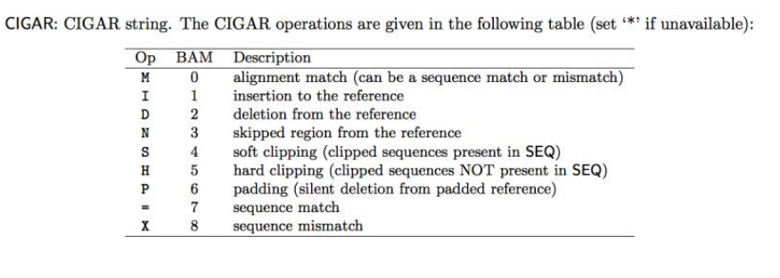

*Assignment goals:*

Write a Reference Based PCR Duplicate Removal tool. That is, given a sorted sam file of uniquely mapped reads, remove all PCR duplicates (retain only a single copy of each read). Develop a strategy that avoids loading everything into memory

*What is a PCR duplicate?*

has same alignment pos:
chr #
5' start of read
strand

same UMI
single end reads

*Cases to account for:*

soft clipping: if there are seqs that are not dupes but have been softed clipped in a way where they look as such, or dupes have been soft clipped in a way where they look like two different seqs but are infact not

to combat this:
I need to look at CIGAR string to determine an alignment position



*Pseudocode:*
```
open UMI file an read them into a set? = known_umis
make an empty set to remember reads already seen
keep track of chromosome #

open input sam file, open output sam file
    for line in input file
        if line is header (@)
            .split line
            pull out qname, flag, rname, pos, cigar, umi(after final : in qname)
            if umi not in umi set skip the read

            if this is a new chromosome empty the seen reads set(file is sorted so this is valid?)

            use the flag to decide fwd or rev strand

            find true start 5' pos
                if fwd strand
                    check CIGAR if softed clipped, sub that # from the pos
                if rev strand
                    add up the matches, indels, or skips in the CIGAR
                    then add that number to start pos
                    if cigar ends with clipping add that as well here?
                    subtract 1

            seen = combine UMI, strand, and actual start pos into one label
            if i have seen this label then it is a dupe and needs to be skipped
            else remember the dupe and read to the output file
            
OUTPUT SHOULD: report how many reads were kept, how many were dupes, and how many had bad UMIs
```
